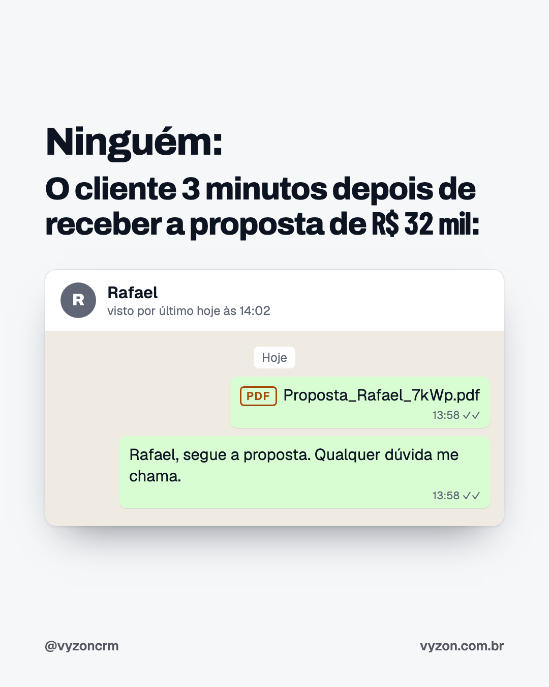
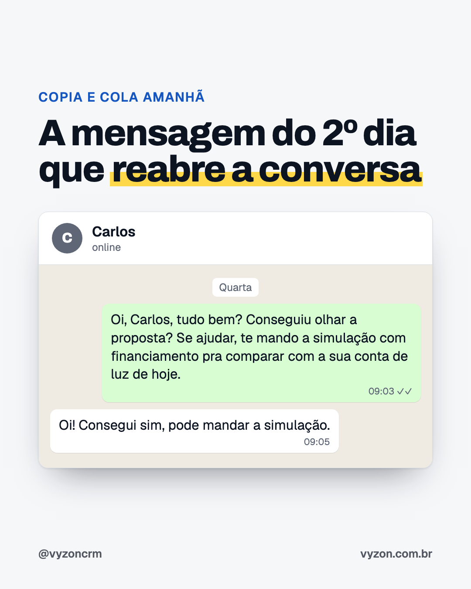
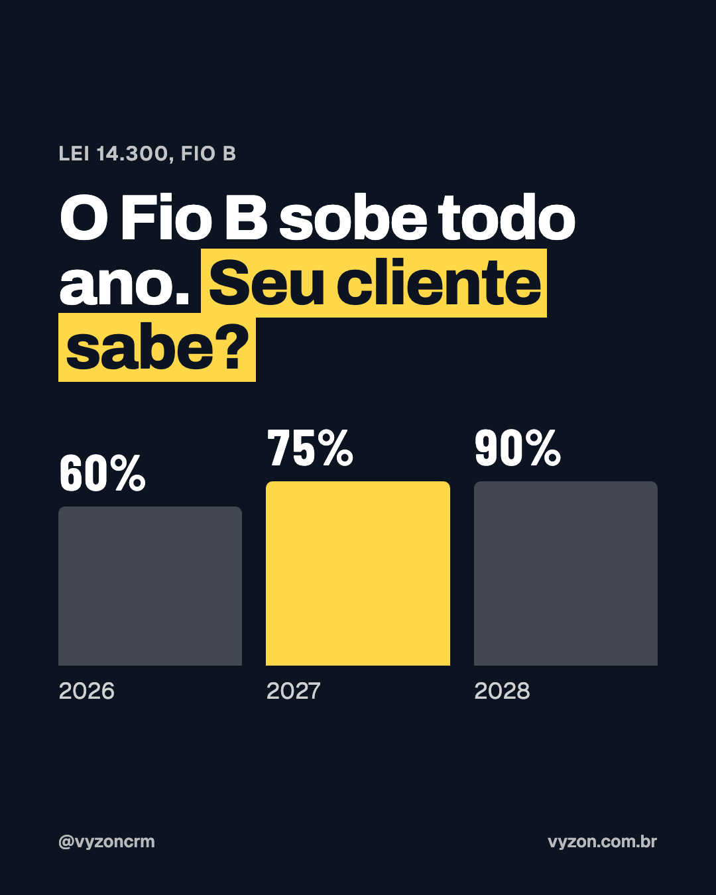
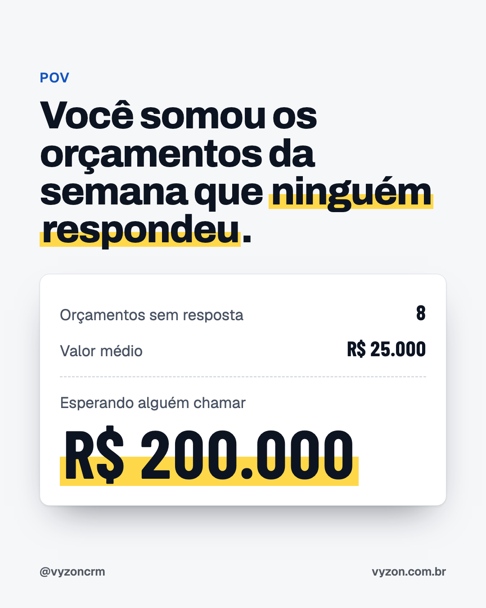
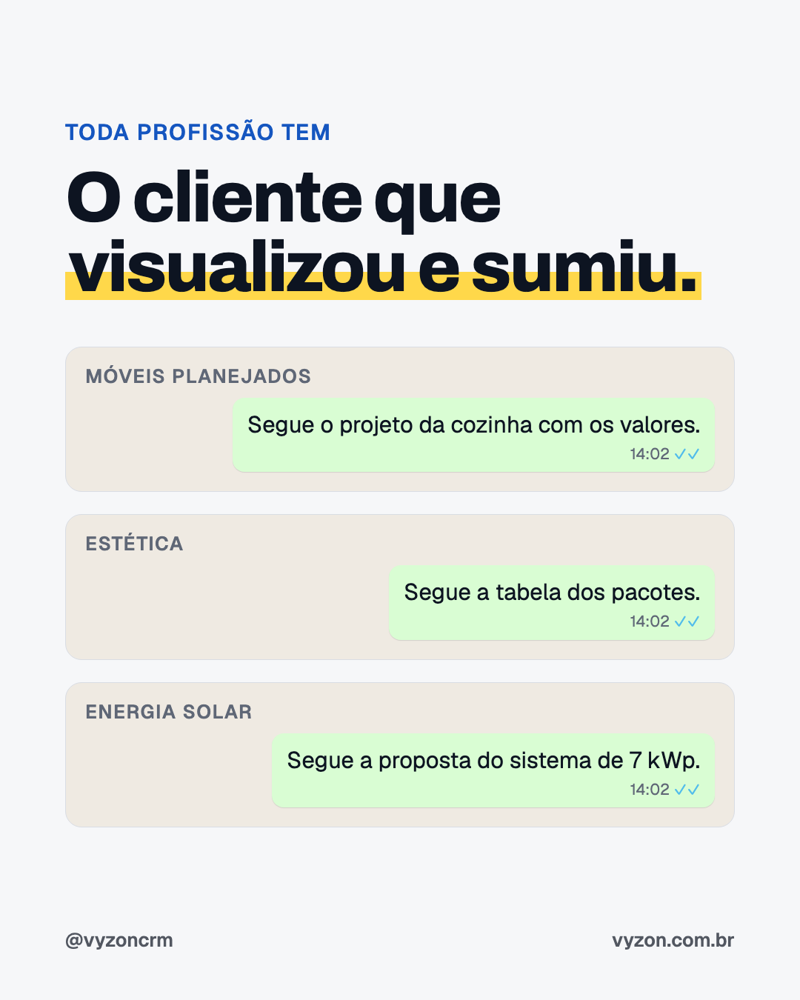
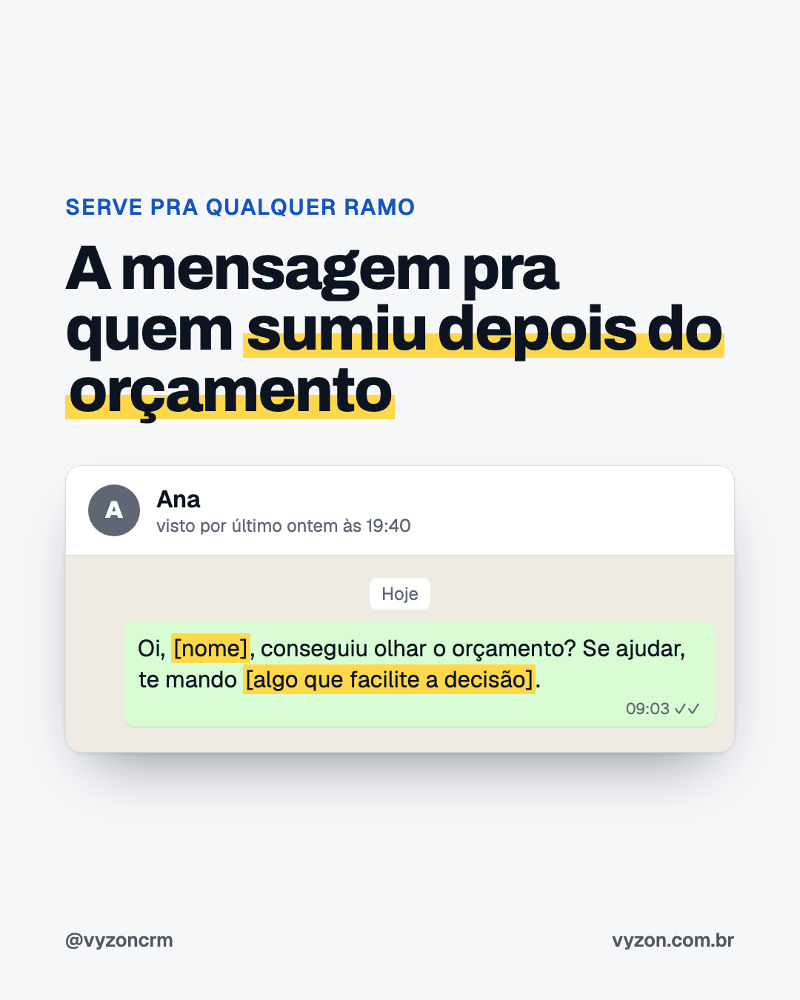
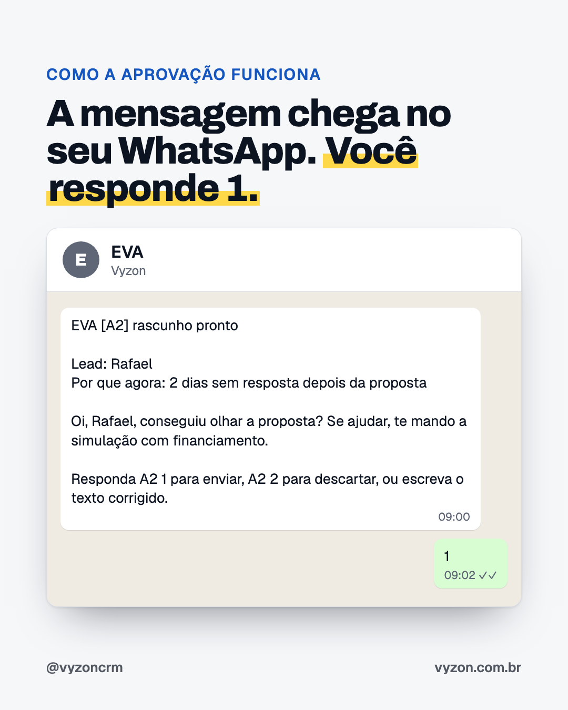

# Instagram @vyzoncrm: 26/10 a 06/11/2026

Três posts por dia útil, às 07:30 (antes da obra), 11:30 (almoço) e 18:30 (fim do dia), e três stories, às 08:00, 12:00 e 19:30.
Os posts 11, 12, 13, 18, 22, 24 e 25 são para qualquer ramo; a oferta continua sendo para integradora solar.

## Agenda

| Dia | Hora | Peça | Formato |
|---|---|---|---|
| seg 26/10 | 07:30 | Post 14 | Frase curta |
| seg 26/10 | 11:30 | Post 01 | Pergunta polêmica (molde Canal Solar) |
| seg 26/10 | 18:30 | Post 15 | Pergunta polêmica |
| ter 27/10 | 07:30 | Post 16 | POV com a lista de conversas |
| ter 27/10 | 11:30 | Post 17 | Checklist salvável |
| ter 27/10 | 18:30 | Post 02 | Meme Ninguém: (molde do nosso 2º melhor post) |
| qua 28/10 | 07:30 | Post 18 | Extra qualquer ramo: meme expectativa e realidade |
| qua 28/10 | 11:30 | Post 03 | Número do setor com fonte + comentário com palavra |
| qua 28/10 | 18:30 | Post 11 | Extra qualquer ramo: identificação (comenta seu ramo) |
| qui 29/10 | 07:30 | Post 19 | Mito ou verdade |
| qui 29/10 | 11:30 | Reel R1 | dia-2-final.mp4 |
| qui 29/10 | 18:30 | Post 04 | Peça pra salvar + comenta MENSAGEM |
| sex 30/10 | 07:30 | Post 20 | Enquete nos comentários |
| sex 30/10 | 11:30 | Post 05 | Lista curta (tradução do integrador) |
| sex 30/10 | 18:30 | Post 21 | Fechamento da semana |
| seg 02/11 | 07:30 | Post 22 | Extra qualquer ramo: o que não mandar |
| seg 02/11 | 11:30 | Post 06 | Assunto do setor (Fio B) com fonte |
| seg 02/11 | 18:30 | Post 12 | Extra qualquer ramo: lista salvável |
| ter 03/11 | 07:30 | Post 23 | Fatura contra parcela (exemplo) |
| ter 03/11 | 18:30 | Post 07 | POV com a fatura |
| qua 04/11 | 07:30 | Post 24 | Extra qualquer ramo: dica |
| qua 04/11 | 11:30 | Post 08 | Frase de impacto (molde Mandou. Viu. Sumiu.) |
| qua 04/11 | 18:30 | Post 13 | Extra qualquer ramo: modelo de mensagem (comenta seu ramo) |
| qui 05/11 | 07:30 | Post 25 | Extra qualquer ramo: a pergunta que falta |
| qui 05/11 | 11:30 | Post 26 | Faz a conta (exemplo) |
| qui 05/11 | 18:30 | Post 09 | Linha do tempo (salvável) |
| sex 06/11 | 07:30 | Post 27 | Convite para o Raio-X |
| sex 06/11 | 11:30 | Post 10 | Produto (molde do nosso melhor post) |
| sex 06/11 | 18:30 | Post 28 | Produto: como a aprovação funciona |
| ter 10/11 | 11:30 | Reel R2 | parado-final.mp4 |

## Stories

| Dia | Hora | Arquivo | Tipo |
|---|---|---|---|
| seg 26/10 | 08:00 | stories/s01.png | Dica |
| seg 26/10 | 12:00 | stories/s02.png | Aviso do post 01 |
| seg 26/10 | 19:30 | stories/s03.png | Pergunta |
| ter 27/10 | 08:00 | stories/s04.png | Dica |
| ter 27/10 | 12:00 | stories/s05.png | Aviso do post 17 |
| ter 27/10 | 19:30 | stories/s06.png | Pergunta |
| qua 28/10 | 08:00 | stories/s07.png | Dica |
| qua 28/10 | 12:00 | stories/s08.png | Aviso do post 03 |
| qua 28/10 | 19:30 | stories/s09.png | Pergunta |
| qui 29/10 | 08:00 | stories/s10.png | Dica |
| qui 29/10 | 12:00 | stories/s11.png | Aviso do post 19 |
| qui 29/10 | 19:30 | stories/s12.png | Pergunta |
| sex 30/10 | 08:00 | stories/s13.png | Dica |
| sex 30/10 | 12:00 | stories/s14.png | Aviso do post 05 |
| sex 30/10 | 19:30 | stories/s15.png | Pergunta |
| seg 02/11 | 08:00 | stories/s16.png | Dica |
| seg 02/11 | 12:00 | stories/s17.png | Aviso do post 06 |
| seg 02/11 | 19:30 | stories/s18.png | Pergunta |
| ter 03/11 | 08:00 | stories/s19.png | Dica |
| ter 03/11 | 12:00 | stories/s20.png | Aviso do post 23 |
| ter 03/11 | 19:30 | stories/s21.png | Pergunta |
| qua 04/11 | 08:00 | stories/s22.png | Dica |
| qua 04/11 | 12:00 | stories/s23.png | Aviso do post 08 |
| qua 04/11 | 19:30 | stories/s24.png | Pergunta |
| qui 05/11 | 08:00 | stories/s25.png | Dica |
| qui 05/11 | 12:00 | stories/s26.png | Aviso do post 26 |
| qui 05/11 | 19:30 | stories/s27.png | Pergunta |
| sex 06/11 | 08:00 | stories/s28.png | Dica |
| sex 06/11 | 12:00 | stories/s29.png | Aviso do post 10 |
| sex 06/11 | 19:30 | stories/s30.png | Pergunta |

## Reels

### R1 · qui 29/10, 11:30

Arquivo: ~/Movies/vyzon-film/entregas/dia-2-final.mp4

```
Mandou a proposta e o cliente sumiu?

No 2º dia sem resposta, a mensagem pra chamar de volta chega pronta no seu WhatsApp. Você responde 1 e ela sai do seu número. Nada vai pro cliente sem você aprovar.

A EVA sugere. Você aprova.

#energiasolar #integradorsolar #vendasnowhatsapp #energiafotovoltaica
```

### R2 · ter 10/11, 11:30

Arquivo: ~/Movies/vyzon-film/entregas/parado-final.mp4

```
Quanto dinheiro está parado no seu WhatsApp agora?

Cada proposta sem resposta é um cliente que já pediu orçamento. No 2º dia, a mensagem pra chamar de volta chega pronta no seu WhatsApp, e você aprova com 1.

Preço de fundador: R$ 97 por mês nos 3 primeiros meses para as 10 primeiras integradoras. Fale com o Markus pelo link da bio.

#energiasolar #integradorsolar #vendasnowhatsapp #energiafotovoltaica
```

## Posts

### 01 · seg 26/10, 11:30

Formato: Pergunta polêmica (molde Canal Solar)


```
Visualizou às 14h. Até agora, nada.

Muito dono de integradora já respondeu isso pra gente: "quem visualiza e some não tem interesse".

Mas ele mandou a conta de luz e pediu orçamento. Interesse tinha. O que muda tudo é se alguém chama de volta, e quando.

E aí, desistiu ou esqueceu? Comenta sua opinião.

#energiasolar #integradorsolar #vendasnowhatsapp #energiafotovoltaica
```

### 02 · ter 27/10, 18:30

Formato: Meme Ninguém: (molde do nosso 2º melhor post)



```
Ele abriu. Viu o valor. Fechou o WhatsApp e foi jantar.

Não é que ele não quer. É que R$ 32 mil não se decide em 3 minutos: tem a parcela, tem a conversa em casa, tem o outro orçamento que ele pediu.

Marca aqui o vendedor que viveu isso hoje.

#energiasolar #integradorsolar #vendasnowhatsapp #energiafotovoltaica
```

### 03 · qua 28/10, 11:30

Formato: Número do setor com fonte + comentário com palavra


```
A integradora típica faz uns 25 orçamentos por mês e fecha 18% deles (Greener, Estudo Estratégico de Geração Distribuída, 1º semestre de 2026).

Ou seja: 20 clientes por mês que já mandaram a conta de luz, já viram o valor e ficaram pelo caminho.

Antes de pagar por lead novo, vale olhar esses 20. Quantos você chamou de volta essa semana? Comenta o número.

#energiasolar #integradorsolar #vendasnowhatsapp #energiafotovoltaica
```

### 04 · qui 29/10, 18:30

Formato: Peça pra salvar + comenta MENSAGEM



```
Sem "e aí, fechamos?". Sem cobrança.

Uma pergunta simples e uma ajuda concreta: a simulação com financiamento do lado da conta de luz que ele paga hoje. Ele compara parcela com conta, não preço com preço.

Salva pra usar no próximo orçamento parado.

Quer as 10 mensagens que mais reabrem conversa? Comenta MENSAGEM que eu te mando.

#energiasolar #integradorsolar #vendasnowhatsapp #energiafotovoltaica
```

### 05 · sex 30/10, 11:30

Formato: Lista curta (tradução do integrador)


```
"Vou pensar" quase nunca é um não. É uma dúvida que o cliente não falou.

Parcela, família ou outro orçamento: cada uma pede uma mensagem diferente. Mandar "e aí, pensou?" pra todas é o jeito mais rápido de perder as três.

Qual dessas você mais escuta? Comenta 1, 2 ou 3.

#energiasolar #integradorsolar #vendasnowhatsapp #energiafotovoltaica
```

### 06 · seg 02/11, 11:30

Formato: Assunto do setor (Fio B) com fonte



```
Pela Lei 14.300, a parte do Fio B cobrada de quem gera a própria energia sobe todo ano: 60% em 2026, 75% em 2027 e 90% em 2028. E cada mês que o cliente passa pensando é mais uma conta de luz cheia.

Isso não é argumento de pressão. É informação que o seu cliente provavelmente não tem, e que ajuda ele a decidir no tempo dele.

Uma boa retomada pode ser só isso: "Lembrei de você porque o Fio B sobe de novo em janeiro. Quer que eu te mostre o que muda na sua conta?"

#energiasolar #integradorsolar #vendasnowhatsapp #energiafotovoltaica
```

### 07 · ter 03/11, 18:30

Formato: POV com a fatura



```
Faz essa conta com os seus números: orçamentos sem resposta vezes o valor médio.

A gente fez com 8 orçamentos de R$ 25 mil, que é um mês comum pra muita integradora. Deu R$ 200 mil esperando alguém chamar de volta.

Qual foi o seu número? Se quiser, o link da bio faz a conta com você.

#energiasolar #integradorsolar #vendasnowhatsapp #energiafotovoltaica
```

### 08 · qua 04/11, 11:30

Formato: Frase de impacto (molde Mandou. Viu. Sumiu.)


```
Saber que abriu é metade.

A outra metade é chamar de volta no dia certo, com a mensagem certa, no meio de duzentas conversas do WhatsApp. É essa metade que vira venda, e é a que quase ninguém faz com constância.

Você chama de volta quem abriu e não respondeu? Comenta SIM ou NÃO.

#energiasolar #integradorsolar #vendasnowhatsapp #energiafotovoltaica
```

### 09 · qui 05/11, 18:30

Formato: Linha do tempo (salvável)


```
No dia 1 o cliente ainda está pensando. Se ninguém chama, cada dia que passa a proposta esfria um pouco: ele esquece o valor, recebe outro orçamento, a conversa em casa não acontece.

O 2º dia é um bom momento pra chamar de volta: ainda é recente e não parece cobrança.

Salva pra lembrar.

#energiasolar #integradorsolar #vendasnowhatsapp #energiafotovoltaica
```

### 10 · sex 06/11, 11:30

Formato: Produto (molde do nosso melhor post)


```
É isso que o Vyzon faz.

Acompanha cada orçamento que sai do seu WhatsApp. No 2º dia sem resposta, a mensagem pra chamar de volta chega pronta, no seu tom. Você responde 1 e ela sai do seu número, com o seu nome. Nada vai sem você aprovar.

R$ 97 por mês, tudo liberado para até 10 pessoas. Sem contrato.

Quer ver funcionando? Link na bio.

#energiasolar #integradorsolar #vendasnowhatsapp #energiafotovoltaica
```

### 11 · qua 28/10, 18:30

Formato: Extra qualquer ramo: identificação (comenta seu ramo)



```
Muda o ramo, muda o valor, a cena é a mesma: o orçamento sai, o cliente visualiza e a conversa para.

E quase sempre ele não disse não. Ele só não respondeu ainda.

Qual é o seu ramo? Comenta aí pra gente ver quantas profissões passam por isso.

#vendasnowhatsapp #vendas #orcamento #pequenosnegocios #energiasolar
```

### 12 · seg 02/11, 18:30

Formato: Extra qualquer ramo: lista salvável


```
Quando o cliente some, a primeira reação é achar que foi o preço e já oferecer desconto.

Muitas vezes ele só esqueceu, precisa conversar com alguém ou está comparando. Nenhum desses se resolve com desconto. Se resolve chamando de volta com uma pergunta.

Salva pra lembrar no próximo orçamento parado.

#vendasnowhatsapp #vendas #orcamento #pequenosnegocios #energiasolar
```

### 13 · qua 04/11, 18:30

Formato: Extra qualquer ramo: modelo de mensagem (comenta seu ramo)



```
Uma pergunta e uma ajuda. Sem "e aí, fechamos?".

O que vai no colchete muda com o ramo:
Móveis planejados: a foto de uma cozinha parecida que você já entregou.
Estética: os dois horários livres da semana.
Energia solar: a simulação com financiamento do lado da conta de luz de hoje.

Manda no 2º dia sem resposta: ainda é recente e não parece cobrança.

Comenta o seu ramo que a gente te diz o que colocar no colchete.

#vendasnowhatsapp #vendas #orcamento #pequenosnegocios #energiasolar
```

### 14 · seg 26/10, 07:30

Formato: Frase curta


```
Lead novo custa anúncio, tempo e paciência. O cliente que já mandou a conta de luz e recebeu a proposta já passou por tudo isso.

Antes de aumentar o anúncio, abre o WhatsApp e procura quem recebeu orçamento e não respondeu. É o lead mais barato que você vai ter essa semana.

#energiasolar #integradorsolar #vendasnowhatsapp #energiafotovoltaica
```

### 15 · seg 26/10, 18:30

Formato: Pergunta polêmica


```
Tem integrador que dá desconto pra todo cliente que demora. Tem integrador que nunca mexe no preço.

O problema do desconto automático: o cliente aprende que esperar compensa. E muitas vezes ele nem estava pensando no preço, só não tinha decidido ainda.

E você, dá desconto pra fechar? Comenta ESTRATÉGIA ou DESESPERO.

#energiasolar #integradorsolar #vendasnowhatsapp #energiafotovoltaica
```

### 16 · ter 27/10, 07:30

Formato: POV com a lista de conversas


```
Fornecedor, grupo da obra, cliente pedindo visita, banco. Quando você chega no orçamento de sexta, ele já está lá embaixo.

Não é falta de interesse seu. É que o WhatsApp mostra primeiro quem falou por último, e quem recebeu proposta e ficou quieto vai descendo.

Também acontece aí? Comenta EU.

#energiasolar #integradorsolar #vendasnowhatsapp #energiafotovoltaica
```

### 17 · ter 27/10, 11:30

Formato: Checklist salvável


```
Boa parte do follow-up acontece antes de mandar a proposta.

Quem combina o próximo contato na hora de mandar não precisa inventar desculpa pra chamar de volta: só cumpre o combinado.

Salva e usa na próxima proposta.

#energiasolar #integradorsolar #vendasnowhatsapp #energiafotovoltaica
```

### 18 · qua 28/10, 07:30

Formato: Extra qualquer ramo: meme expectativa e realidade


```
Ninguém manda orçamento esperando silêncio. Mas é o que mais acontece, em qualquer ramo.

Muitas vezes a diferença entre quem vende mais e quem vende menos não está no orçamento. Está no que acontece depois do silêncio.

Marca alguém que vive a realidade.

#vendasnowhatsapp #vendas #orcamento #pequenosnegocios #energiasolar
```

### 19 · qui 29/10, 07:30

Formato: Mito ou verdade


```
"E aí, fechamos?" é cobrança. "Conseguiu olhar? Te mando a simulação com financiamento pra comparar com a sua conta" é atendimento.

O cliente sente a diferença.

Concorda? Comenta MITO ou VERDADE.

#energiasolar #integradorsolar #vendasnowhatsapp #energiafotovoltaica
```

### 20 · sex 30/10, 07:30

Formato: Enquete nos comentários


```
Tem quem jure que áudio aproxima. Tem quem diga que ninguém escuta áudio de vendedor.

No seu caso, o que o cliente responde mais? Comenta ÁUDIO ou TEXTO.

#energiasolar #integradorsolar #vendasnowhatsapp #energiafotovoltaica
```

### 21 · sex 30/10, 18:30

Formato: Fechamento da semana


```
Antes de fechar a semana, abre o WhatsApp e conta: quantos clientes receberam orçamento e não responderam?

Não precisa chamar ninguém hoje. Só anota. Segunda de manhã, antes de qualquer lead novo, você começa por essa lista.

Comenta o seu número.

#energiasolar #integradorsolar #vendasnowhatsapp #energiafotovoltaica
```

### 22 · seg 02/11, 07:30

Formato: Extra qualquer ramo: o que não mandar


```
As três têm o mesmo problema: pedem algo do cliente e não oferecem nada.

No lugar, manda uma pergunta e uma ajuda: "Conseguiu olhar o orçamento? Se ajudar, te mando [algo que facilite a decisão]."

Qual dessas você já mandou? Comenta 1, 2 ou 3.

#vendasnowhatsapp #vendas #orcamento #pequenosnegocios #energiasolar
```

### 23 · ter 03/11, 07:30

Formato: Fatura contra parcela (exemplo)


```
R$ 32 mil assusta. R$ 610 por mês no lugar de uma conta de R$ 680 é outra conversa.

Quando o cliente some depois da proposta, uma boa retomada é mandar essa comparação com os números dele. Ele entende sem precisar abrir o PDF de novo.

Valores de exemplo. Faça com os números do seu cliente.

#energiasolar #integradorsolar #vendasnowhatsapp #energiafotovoltaica
```

### 24 · qua 04/11, 07:30

Formato: Extra qualquer ramo: dica


```
Sem validade, o orçamento pode esperar pra sempre. Com validade, você tem um motivo honesto pra chamar de volta: "Oi, a proposta vale até sexta. Quer que eu segure esse valor pra você?"

Só vale se for verdade. Prazo inventado o cliente percebe.

#vendasnowhatsapp #vendas #orcamento #pequenosnegocios #energiasolar
```

### 25 · qui 05/11, 07:30

Formato: Extra qualquer ramo: a pergunta que falta


```
Sócio, marido, esposa, pai. Muitas vezes quem pede o orçamento não decide sozinho, e quem decide nunca viu a sua proposta.

Pergunta antes de mandar. Se tiver mais alguém, manda um resumo curto que dê pra mostrar em casa.

Você costuma perguntar isso? Comenta SIM ou NÃO.

#vendasnowhatsapp #vendas #orcamento #pequenosnegocios #energiasolar
```

### 26 · qui 05/11, 11:30

Formato: Faz a conta (exemplo)


```
Não precisa recuperar todos os orçamentos parados. Um por mês já muda o ano.

Com valor médio de R$ 25 mil, são R$ 300 mil em 12 meses que vieram de clientes que já tinham pedido orçamento.

Faz com o seu valor médio e comenta o resultado.

#energiasolar #integradorsolar #vendasnowhatsapp #energiafotovoltaica
```

### 27 · sex 06/11, 07:30

Formato: Convite para o Raio-X


```
Você não precisa contar na mão.

O Raio-X do Vyzon lista os orçamentos que você mandou pelo WhatsApp nos últimos 90 dias e que ficaram sem resposta: há quantos dias cada um está parado, quanto eles somam e a mensagem pronta pra chamar cada cliente de novo. Nada é enviado pros seus clientes.

É grátis. Link na bio.

#energiasolar #integradorsolar #vendasnowhatsapp #energiafotovoltaica
```

### 28 · sex 06/11, 18:30

Formato: Produto: como a aprovação funciona



```
Funciona assim: no 2º dia sem resposta, a EVA manda no seu WhatsApp o rascunho pra chamar o cliente de volta, com o motivo.

Você responde 1 e a mensagem sai do seu número. Responde 2 e ela é descartada. Ou escreve o texto do seu jeito no lugar. Mudou de ideia logo depois do 1? Manda "desfazer" em até 20 segundos.

Nada vai pro cliente sem você aprovar.

R$ 97 por mês, tudo liberado para até 10 pessoas. Link na bio.

#energiasolar #integradorsolar #vendasnowhatsapp #energiafotovoltaica
```
